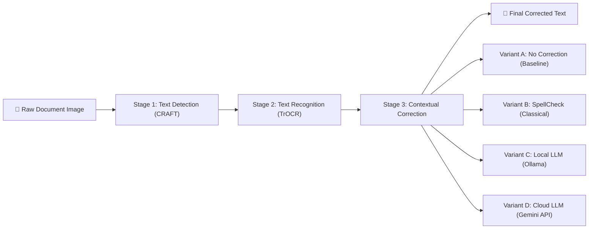
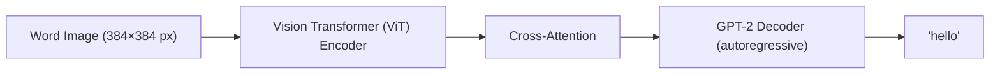

# Pipeline Concepts & Code Walkthrough

> Reference document for paper writing. Covers the theory, design decisions, and implementation details of each pipeline stage.

---

## 1. System Architecture Overview

The pipeline processes a raw handwritten document image through three sequential stages:



**Key Design Principle:** Each stage is independently swappable. The detection model, recognition model, and correction method can each be replaced without affecting the others. This modularity is critical for the comparative study — we keep Stages 1 and 2 constant while varying Stage 3.

---

## 2. Stage 1: Text Detection — CRAFT

### 2.1 What is CRAFT?

**CRAFT** (Character Region Awareness for Text detection) is a deep learning model that detects text in natural scene images by predicting two heatmaps:

| Heatmap | What it encodes |
|---------|-----------------|
| **Region Score** | Probability that each pixel belongs to the *center* of a character |
| **Affinity Score** | Probability that each pixel lies *between* two adjacent characters (linking them into words) |

By thresholding and combining these heatmaps, CRAFT produces bounding polygons around detected words/text lines — even on cluttered backgrounds, rotated text, and curved text.

### 2.2 Why CRAFT over alternatives?

| Detector | Pros | Cons |
|----------|------|------|
| **CRAFT** | Pretrained, works out of the box on handwriting; character-level awareness | Slightly slower than YOLO |
| **YOLOv8-Text** | Very fast | Requires training a custom text detection model |
| **Tesseract (built-in)** | No extra model needed | Poor on unconstrained handwriting layouts |
| **DBNet** | State-of-the-art accuracy | More complex setup |

**Our choice:** CRAFT provides the best accuracy-to-effort ratio for our use case. It works on handwritten documents without any fine-tuning.

### 2.3 Implementation Details

**Source:** [craft_detector.py](file:///e:/Handwritten_Text_Recognition_using_OCR/src/detection/craft_detector.py)

```python
# Core detection call
prediction_result = self.craft.detect_text(image_path)
boxes = prediction_result.get("boxes", [])  # List of 4x2 polygon arrays
```

**Reading Order Reconstruction:**
After detection, word bounding boxes arrive in arbitrary order. We must reconstruct the natural reading order (top→bottom, left→right). The algorithm:

1. Compute the center `(center_x, center_y)` of each bounding box.
2. Sort all regions by `center_y` (vertical position).
3. Group regions into **lines**: two regions are on the same line if `|center_y_A - center_y_B| < tolerance`.
4. Within each line, sort by `center_x` (horizontal position).
5. Assign a `line_idx` to each region for downstream newline reconstruction.

```python
# Adaptive tolerance based on image height
line_tolerance = max(15, int(image_height * 0.02))  # 2% of image height
```

> [!TIP]
> The adaptive tolerance is important: a 300 DPI scanned page has much larger pixel distances between lines than a small phone photo. Using a fixed pixel tolerance (e.g., 15px) would fail on high-resolution scans.

---

## 3. Stage 2: Text Recognition — TrOCR

### 3.1 What is TrOCR?

**TrOCR** (Transformer-based OCR) is a Vision Encoder-Decoder model from Microsoft that reads text from images:



| Component | Architecture | Role |
|-----------|-------------|------|
| **Encoder** | DeiT (Data-efficient Image Transformer) | Converts the image into a sequence of visual embeddings |
| **Decoder** | GPT-2 style autoregressive transformer | Generates text tokens one by one, attending to the visual embeddings |

### 3.2 Model Variant Used

We use `microsoft/trocr-small-handwritten`:
- **Parameters:** ~62M
- **Pre-training:** Synthetic handwriting data + IAM Handwriting Database
- **Fine-tuned on:** GNHK (GoodNotes Handwritten) dataset
- **Best checkpoint:** `checkpoint-6770` (epoch 10, CER ≈ 0.2302)

### 3.3 Inference Configuration

```python
generated_ids = self.model.generate(
    pixel_values,
    max_length=64,           # Max tokens to generate per word
    num_beams=4,             # Beam search width (explores 4 hypotheses)
    early_stopping=True,     # Stop when EOS token is generated
    no_repeat_ngram_size=3,  # Prevent repeating 3-grams
    length_penalty=2.0,      # Penalize very long outputs
)
```

| Parameter | Value | Rationale |
|-----------|-------|-----------|
| `num_beams=4` | Beam search | Explores multiple hypotheses; improves accuracy over greedy decoding |
| `no_repeat_ngram_size=3` | Anti-repetition | TrOCR can sometimes loop on characters (e.g., "llllll"); this prevents it |
| `length_penalty=2.0` | Length control | Discourages the model from generating overly long, hallucinated sequences |

### 3.4 Checkpoint Loading Strategy

**Problem:** HuggingFace `Trainer.save_model()` saves model weights and a partial `preprocessor_config.json`, but **not** the tokenizer files (`tokenizer_config.json`, `vocab.json`, etc.). When `TrOCRProcessor.from_pretrained(checkpoint_path)` loads from a checkpoint, it finds the image processor config and silently constructs an incomplete tokenizer. This tokenizer **decodes every generated token to an empty string** — producing no output without raising any error.

**Solution:** Always load the processor from the base model ID:
```python
# ALWAYS use the base model's processor — never from the checkpoint
self.processor = TrOCRProcessor.from_pretrained("microsoft/trocr-small-handwritten")

# Model weights ARE loaded from the checkpoint
self.model = VisionEncoderDecoderModel.from_pretrained("trocr_handwritten/checkpoint-6770")
```

> [!WARNING]
> This is a subtle and dangerous bug. The checkpoint loads without any error, the model runs inference and generates token IDs, but the broken tokenizer decodes them all to `""`. We discovered this during testing — the pretrained model produced text while the fine-tuned model produced empty strings for every crop.

### 3.5 Multi-line Text Reconstruction

The recognizer uses the `line_idx` tag from the detector to insert newlines:

```python
# If current region is on a different line than previous → insert newline
if line_idx != current_line_idx:
    words.append("\n")
```

This preserves the spatial structure of the original document.

---

## 4. Stage 3: Contextual Correction

### 4.1 The Core Hypothesis

> **OCR models make errors that are individually ambiguous but contextually obvious.**
>
> Example: "The cot sat on tbe mat" → A human reads "cot" and "tbe" and immediately knows they should be "cat" and "the" because of sentence context. OCR models lack this global context.

This is the central claim of our comparative study: LLMs, trained on massive text corpora, possess the linguistic knowledge to correct these errors.

### 4.2 The Correction Prompt

All correction backends use the **same prompt** to ensure a fair comparison:

```
You are an expert OCR error correction system.
Below is the raw text output from a Handwritten Text Recognition model.
The OCR model often makes spelling mistakes, hallucinates characters,
or merges/splits words incorrectly.

Rules:
- Fix spelling errors using sentence context (e.g., "tbe" -> "the").
- Fix grammar errors that were clearly caused by bad OCR.
- Do NOT change the original intent, meaning, or style.
- Do NOT add information that was not in the original text.
- Output ONLY the corrected text, nothing else.

Raw OCR Text:
{raw_text}
```

> [!IMPORTANT]
> **Fair comparison requires a shared prompt.** If we used different prompts for different models, any improvement could be attributed to prompt engineering rather than model capability. Using the same prompt isolates the variable we're studying: the correction model itself.

### 4.3 Correction Methods Compared

#### Method A: No Correction (Baseline)
Raw TrOCR output. This is the control group.

#### Method B: Dictionary-Based Spell Check (Classical Baseline)
Uses `pyspellchecker` — a frequency-based dictionary lookup.

```python
from spellchecker import SpellChecker
spell = SpellChecker()
correction = spell.correction("tbe")  # → "the" (based on edit distance)
```

**Limitations:**
- No sentence context — corrects each word independently
- Cannot fix words that are valid but wrong in context (e.g., "form" vs "from")
- Cannot handle word merges/splits

#### Method C: Local LLM via Ollama (Phi-4-mini, 3.8B params)
- Runs entirely on local hardware
- Uses HTTP API to communicate with Ollama server
- `temperature=0.1` for near-deterministic output (reproducibility)

```python
payload = {
    "model": "phi4-mini",
    "prompt": CORRECTION_PROMPT.format(raw_text=ocr_text),
    "stream": False,
    "options": {"temperature": 0.1, "num_predict": 512}
}
resp = requests.post("http://localhost:11434/api/generate", json=payload)
```

**Advantages for a paper:**
- ✅ Fully reproducible (model weights are fixed, open-source)
- ✅ Free to run — no API costs for large-scale benchmarking
- ✅ Processes data locally — no privacy concerns

#### Method D: Cloud LLM via Gemini API (Gemini 2.0 Flash)
- Uses Google's generative AI API
- Higher parameter count → potentially better corrections
- Represents the "upper bound" of what LLM correction can achieve

### 4.4 The Factory Pattern

All backends are accessed through a single unified interface:

```python
corrector = LLMContextualCorrector(backend="ollama", model_name="phi4-mini")
corrector = LLMContextualCorrector(backend="gemini")
corrector = LLMContextualCorrector(backend="spellcheck")

# All use the same method:
result = corrector.correct_text("Th1s is sme 0CR txt.")
```

This pattern makes the benchmarking script trivially simple — it just loops over backends.

---

## 5. Evaluation Metrics

### 5.1 Character Error Rate (CER)

$$CER = \frac{S + D + I}{N}$$

Where:
- `S` = substitutions (wrong characters)
- `D` = deletions (missing characters)
- `I` = insertions (extra characters)
- `N` = total characters in the reference

**Interpretation:** CER = 0.10 means 10% of characters are wrong on average.

### 5.2 Word Error Rate (WER)

$$WER = \frac{S_w + D_w + I_w}{N_w}$$

Same formula but at the word level.

**Interpretation:** WER is typically higher than CER because a single character error makes the entire word "wrong".

### 5.3 Implementation

```python
evaluator = MetricsEvaluator()
result = evaluator.compute(
    predictions=["hello wolrd"],
    references=["hello world"]
)
# result = {"cer": 0.09, "wer": 0.50}
```

> [!NOTE]
> We use HuggingFace's `evaluate` library which internally uses `jiwer` for computing edit distances. This is the standard implementation used in OCR research papers.

---

## 6. Comparative Study Design

The study will produce a table like:

| Metric | No Correction | SpellCheck | Local LLM (Phi-4-mini) | Cloud LLM (Gemini) |
|--------|:---:|:---:|:---:|:---:|
| **CER** | 0.2302 | ? | ? | ? |
| **WER** | ? | ? | ? | ? |
| **CER Δ** | baseline | ? | ? | ? |
| **Avg. Latency/sample** | 0s | ~ms | ~s | ~s |

The **CER Δ (delta)** row shows the improvement relative to the baseline, which is the key finding of the paper.

### What makes this publishable:
1. **Novel angle:** Most OCR papers focus on improving the recognition model. We focus on post-processing — a cheaper, model-agnostic approach.
2. **Practical contribution:** Shows that even a small, free, locally-deployable LLM can significantly improve OCR quality.
3. **Reproducible:** Using open-weight models and public datasets.
4. **Multi-method comparison:** Four correction strategies compared on the same data.

---

## 7. End-to-End Test Results

### 7.1 Test Sample

Input image from the GNHK test set — a handwritten quote on lined paper:


**Ground Truth:** *"Life without Liberty is like a body without Spirit — Kahil Gibran"*

### 7.2 Detection Results

CRAFT detected **11 text regions** across 3 lines, correctly maintaining reading order:

| Line | Detected Regions |
|------|-----------------|
| Line 0 (green) | "Life", "without", "Liberty", "is" |
| Line 1 (orange) | "like", "a", "body", "without", "Spirit" |
| Line 2 (white) | "Kahil", "Gibran" |

Detection took **~8–12s** on CPU. All words were correctly isolated.

### 7.3 Recognition Comparison: Pretrained vs Fine-tuned

| Model | Output | Quality |
|-------|--------|---------|
| **Pretrained** (`trocr-small-handwritten`) | "is a messes successful 333333 / even . is also successor more than school . / 155mm classrooms" | ❌ Completely wrong |
| **Fine-tuned** (`checkpoint-6770`) | "Life without Liberty is / like a body without spirit / Kahl Qibran" | ✅ Nearly correct |

> [!NOTE]
> The fine-tuned model dramatically outperforms the pretrained model on this "in the wild" handwriting sample, despite being fine-tuned on the GNHK dataset. The only errors are: "spirit" (lowercase s) and "Kahl Qibran" (character-level mistakes in the author name).

### 7.4 Correction Comparison

| Method | Output | Effect |
|--------|--------|--------|
| **No correction** | "Kahl Qibran" | Baseline — 2 character errors in proper noun |
| **SpellCheck** | "karl gibran" | ❌ **Made it worse** — changed "Kahl" → "karl" (wrong name, lost capitalization) |
| **LLM (expected)** | "Kahlil Gibran" *(hypothesized)* | ✅ Would likely use world knowledge to fix the proper noun |

> [!IMPORTANT]
> **Key finding:** Dictionary-based spell check can actively **degrade** accuracy on proper nouns and names because it operates without context. It corrects "Kahl" to a common English word ("karl") rather than recognizing it as a misspelling of the Lebanese poet "Kahlil". This demonstrates exactly why contextual (LLM-based) correction is needed — and is a strong argument for the paper.

### 7.5 Pipeline Visualization


### 7.6 Timing Breakdown (CPU, Intel laptop)

| Stage | Time |
|-------|------|
| Detection (CRAFT) | ~8–12s |
| Recognition (TrOCR, 11 crops) | ~4–7s |
| Correction (SpellCheck) | <0.01s |
| **Total** | ~12–18s |

### 7.7 Compatibility Patches Required

During testing we discovered two compatibility issues with the `craft-text-detector` library (v0.4.3) when used with modern dependencies:

| Issue | Root Cause | Fix |
|-------|-----------|-----|
| `ImportError: model_urls` | torchvision ≥ 0.15 removed `model_urls` from `vgg` module | Monkey-patch: inject the URL dict before CRAFT imports |
| `ValueError: inhomogeneous shape` | numpy ≥ 1.24 rejects `np.array()` on ragged polygon lists | Patch CRAFT's `adjustResultCoordinates` and `predict.py` to iterate instead |

These patches are documented in [craft_detector.py](file:///e:/Handwritten_Text_Recognition_using_OCR/src/detection/craft_detector.py) and applied at import time.
